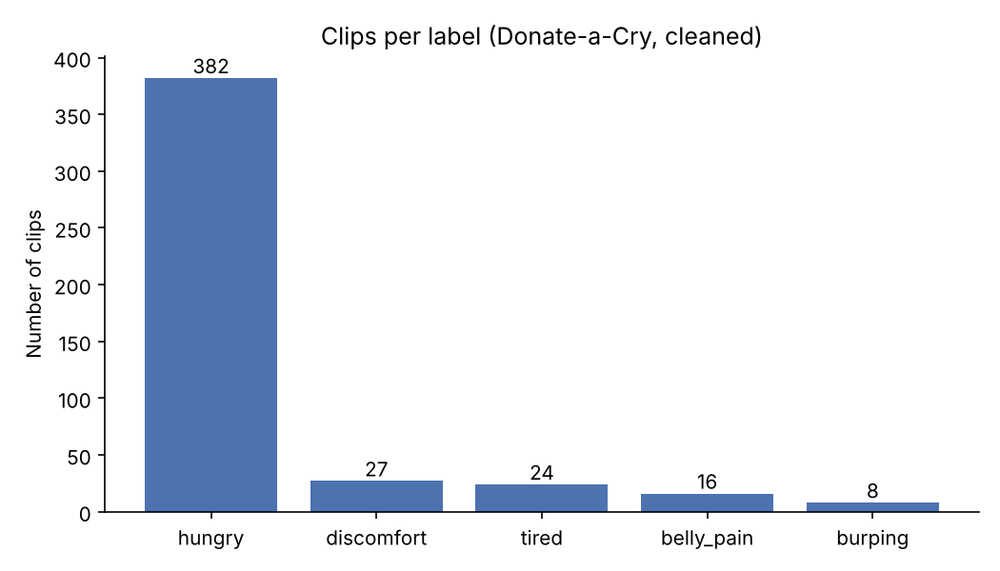
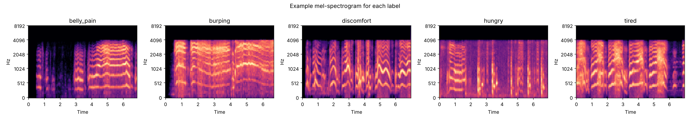

# Baby Cry Translator

Listens to a baby crying and predicts why: **hungry, tired, belly pain, burping, or discomfort**.

Audio → mel-spectrogram (librosa) → model → probabilities, e.g. "70% hungry, 20% tired".

## Status

- [x] Step 1: explore the dataset, make spectrograms
- [ ] Step 2: spectrogram feature pipeline
- [ ] Step 3: baseline model (pretrained YAMNet embeddings + small classifier)
- [ ] Step 4: custom CNN on spectrograms
- [ ] Step 5: evaluation (split by baby, confusion matrix, per-class F1)
- [ ] Step 6: Streamlit app
- [ ] Step 7 (bonus): dog mode

## Setup

```bash
pip install -r requirements.txt
git clone https://github.com/gveres/donateacry-corpus.git data/donateacry-corpus
python src/step1_explore.py --data data/donateacry-corpus/donateacry_corpus_cleaned_and_updated_data
```

## What step 1 found

| Label | Clips | Different babies |
|---|---|---|
| hungry | 382 | 205 |
| discomfort | 27 | 16 |
| tired | 24 | 16 |
| belly_pain | 16 | 7 |
| burping | 8 | 7 |

- 457 clips, all about 7 seconds long, from 221 different phones (roughly, babies).
- **Very imbalanced:** 84% of clips are "hungry". A model that always says "hungry" would get 84% accuracy, so accuracy alone is meaningless here. We'll use per-class F1 and a confusion matrix.
- **The recordings stop at 4 kHz** (they were recorded at 8 kHz), so there's nothing above 4 kHz in the spectrograms. We'll use an 8 kHz sample rate going forward.
- Several babies have multiple clips, so train/test must be split **by baby**, or the model will just learn to recognize voices.




## Data & credit

Trained on the [Donate-a-Cry corpus](https://github.com/gveres/donateacry-corpus), released under the Open Database License (ODbL) 1.0; contents under the Database Contents License (DbCL) 1.0. The audio isn't stored in this repo. Labels were applied by parents, so they are their best guesses rather than verified truth.
